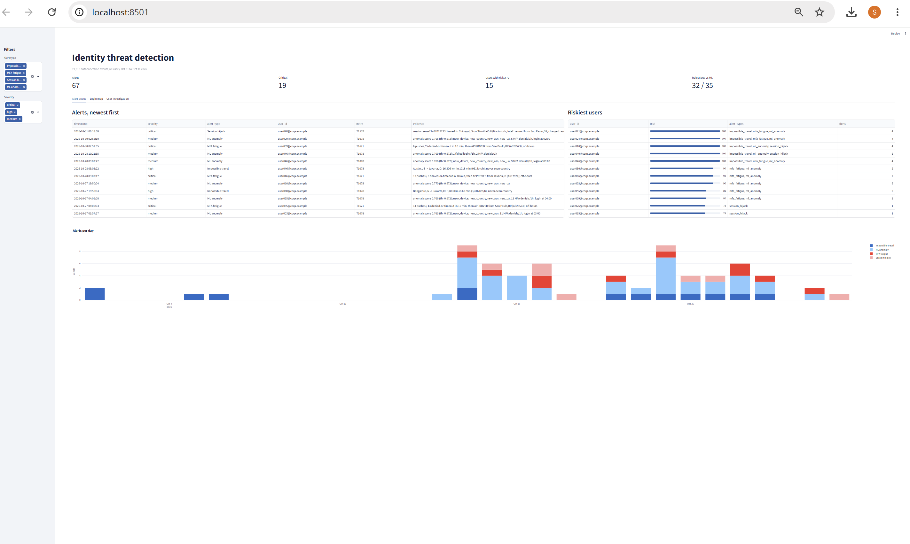
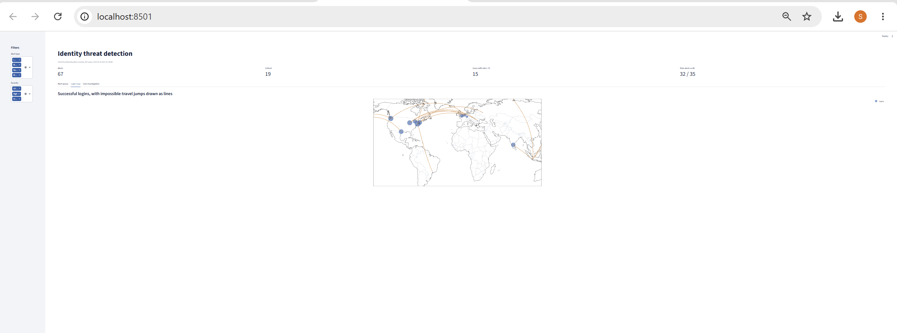
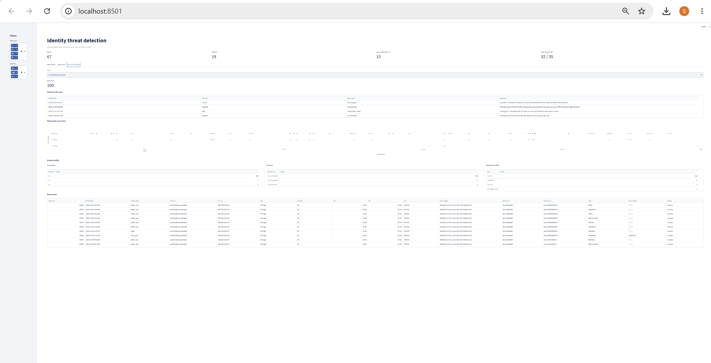

# Identity Threat Detection & Response (ITDR)

Detects **impossible travel**, **MFA fatigue**, and **session hijacking** in authentication logs
using rule-based detections plus an Isolation Forest anomaly model, then rolls everything up into
a per-user risk score and an analyst dashboard. Detections are also provided as Microsoft Sentinel
KQL, Splunk SPL and Sigma rules.
   ## Screenshots

   
   
   
| Detection | MITRE ATT&CK | Logic |
|---|---|---|
| Impossible travel | T1078 | Consecutive logins > 500 km apart at > 900 km/h, skipping trusted / familiar ASNs |
| MFA fatigue | T1621 | ≥ 5 pushes with ≥ 3 denied/timed out in 10 min, then an approval |
| Session hijacking | T1539, T1550.004 | Session token reused with a different country, user agent, or device than it was issued with |
| ML anomaly | T1078 | Isolation Forest over per-user features (new device/country/ASN, travel speed, failed logins, MFA denials, hour) |

## Architecture

```
data_generator/  ->  data/auth_logs.csv  ->  detections/ (rules)  ─┐
loaders/ (real Entra ID export) ─┘          ml/ (features + IF)  ───┼─> scoring/risk.py -> output/ -> dashboard/
                                                                    └─> evaluate.py (precision / recall)
```

## Step-by-step

### 1. Set up
```bash
python -m venv .venv
source .venv/bin/activate          # Windows: .venv\Scripts\activate
pip install -r requirements.txt
```

### 2. Generate labeled synthetic logs
```bash
python -m data_generator.generate_logs --users 60 --days 30 --attacks 10 --evasive 0.25
```
Creates about 18k events: normal logins with realistic noise (corporate VPN, consumer VPNs,
business travel, wifi-to-cellular switches, slow MFA approvals, typos) plus labeled attacks.
`--evasive` controls how many attacks try to dodge the rules (residential proxies, slow push
bombing, cloned user agents), which is what makes the evaluation honest.

### 3. Run the pipeline
```bash
python run_pipeline.py
```
Writes to `output/`: `alerts.csv`, `alerts.json` (one JSON alert per line, ready for a SOAR or
ticketing tool), `user_risk.csv`, `ml_scores.csv`, and `evaluation.md`.

### 4. Run the tests
```bash
python -m pytest tests
```

### 5. Open the dashboard
```bash
streamlit run dashboard/app.py
```
Tabs: alert queue with risky-user ranking, world map with impossible-travel jumps, and a
per-user investigation view (alerts, MFA push timeline, known profile, raw events).

### 6. Tune and evaluate (the part interviewers ask about)
All thresholds live in `config.py`. Try these and record the before/after numbers:

- Set `SUPPRESS_FAMILIAR_ASN = False` and rerun. On the default seed, impossible-travel alerts jump
  from 13 to 105 and precision drops from 0.69 to 0.18 because of consumer VPN users. That's a
  real tuning story.
- Lower `MFA_MIN_PUSHES` to 3 and watch slow push bombing get caught at the cost of more noise.
- Change `ISOLATION_CONTAMINATION` and compare ML precision vs recall.
- Raise `--evasive` to 0.5 and note which attacks only the ML layer catches.

Sample results (seed 42, 10 attacks per type, 25% evasive):

| Detector | Alerts | Precision | Recall |
|---|---|---|---|
| Impossible travel | 13 | 0.69 | 0.70 |
| MFA fatigue | 10 | 1.00 | 1.00 |
| Session hijack | 9 | 1.00 | 0.90 |
| ML anomaly | 35 | 0.49 | 0.57 (all attack types) |

Rules are precise but miss evasive attacks; the ML layer is noisier but picks some of them up
(for example, all slow MFA bombing attacks were caught by at least one detector). That trade-off
is why real ITDR products combine both.

### 7. Run on real logs (optional)
Create a free Microsoft Entra ID tenant (Microsoft 365 Developer Program), generate some sign-ins
and MFA denials from your own phone, export **Sign-in logs > Download > JSON**, then:
```bash
python -m loaders.entra_signins SignIns.json data/real_logs.csv
python run_pipeline.py --logs data/real_logs.csv
```
Evaluation is skipped automatically because real logs have no labels.

### 8. Deploy the SIEM versions
`siem_rules/` contains the same detections for production tools:
- `sentinel_*.kql`: paste into Microsoft Sentinel > Logs, then save as analytics rules.
- `splunk_mfa_fatigue.spl`: for Okta logs in Splunk.
- `okta_mfa_fatigue.yml`: Sigma correlation rule, convertible with `sigma convert`.

Field names follow the vendor schemas but verify them against your tenant before relying on them.

### 9. Response
`playbooks/response_playbooks.md` gives triage, containment, and hardening steps for each alert type.

## Project layout
```
config.py                  thresholds and weights
data_generator/            synthetic users, normal traffic, attack injection
loaders/entra_signins.py   real Entra ID export -> project schema
detections/                impossible_travel.py, mfa_fatigue.py, session_hijack.py
ml/                        features.py (no-leakage per-user features), anomaly.py (Isolation Forest)
scoring/risk.py            0-100 user risk score
evaluate.py                precision / recall vs ground truth
run_pipeline.py            end-to-end runner
dashboard/app.py           Streamlit analyst UI
siem_rules/                KQL, SPL, Sigma
playbooks/                 incident response
tests/                     unit tests for each rule
```

## Ideas to extend
- Stream events in real time (Kafka or tailing a file) instead of batch.
- Add threat-intel enrichment (Tor exit nodes, known-bad IP lists).
- Graph analysis linking users, IPs, and devices to find shared attacker infrastructure.
- Ship logs into Elastic or Splunk Free and build the dashboard there.
